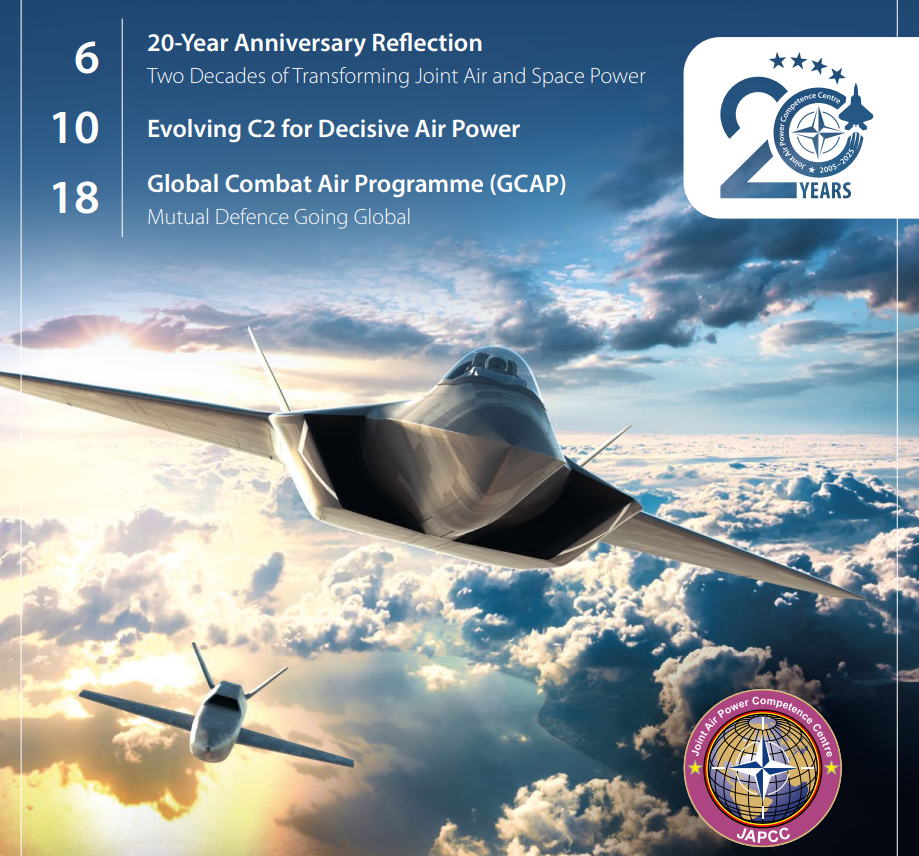
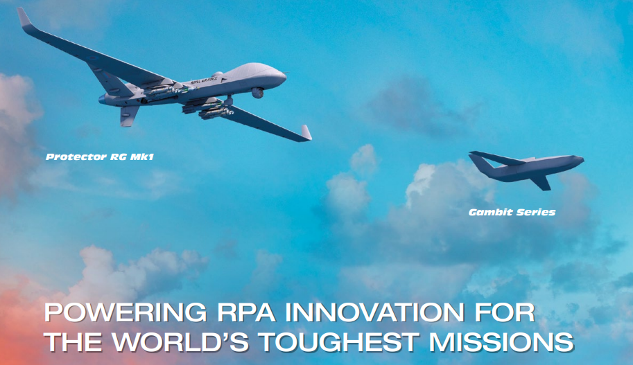
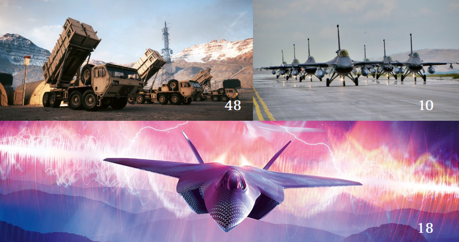
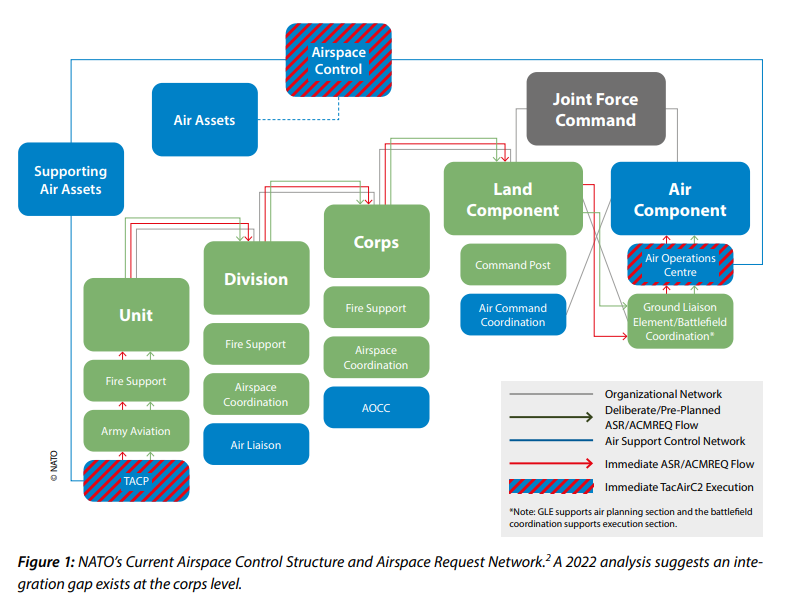
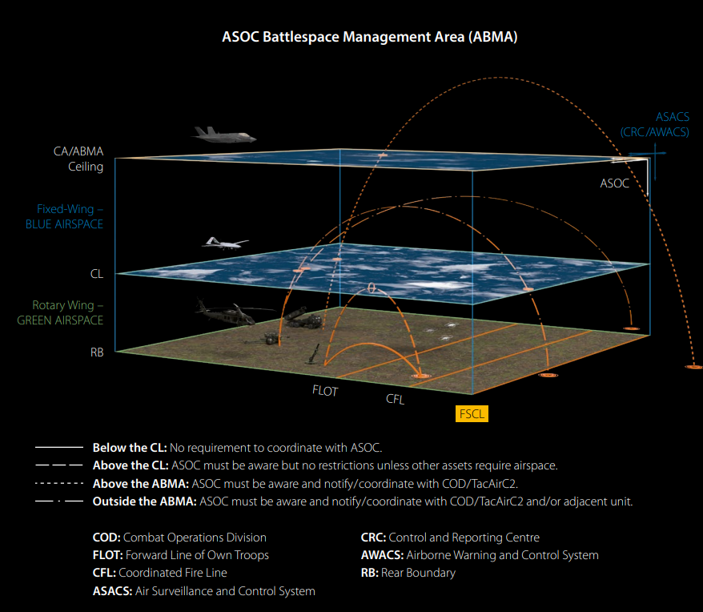

# NATO 2025 Defense Panorama: Sixth Generation Aircraft, High-Speed Supersonic Defense, and Multi-Domain Operational Innovation

NATO's 2025 Defense Panorama: Sixth-Generation Aircraft, High-Speed Supersonic Defense, and Multi-Domain Operational Innovation
I. National Defense Strategy: NATO's Multi-Domain Operations and Command System Innovation
2. Regional defense and deterrence layouts confronting major power competition, NATO focuses on enhancing cross-regional coordination: On one hand, through the "Agile Combat Deployment (ACE)" concept, it enhances the rapid mobility and dispersed deployment capabilities of troops in complex environments; on the other hand, relying on transnational projects such as the Global Operational Air Capability (GCAP), it integrates resources from European and Indo-Pacific allies to construct a comprehensive deterrence system, addressing the threat of anti-access/area denial (A2/AD).
II. Military Equipment: Sixth-Generation Aircraft, High-Speed and Intelligent Equipment Leading the Way
Project GCAP: A sixth-generation fighter aircraft jointly developed by the United States, Japan, and Italy. Centered on "system of systems," it integrates manned and unmanned combat air vehicles (CCA), featuring cross-domain connectivity, multi-payload compatibility (kinetic/non-kinetic weapons, advanced sensors, distributed computing), etc. It can deeply integrate into NATO's existing equipment system and complement F-35.
★  
Unmanned Aerial Vehicles and Long-Endurance Platforms: The MQ-9B STOL Short Takeoff and Landing UAV achieves deployment in extreme cold and harsh environments, while the Gambit series of jet fighters provide comprehensive perception across the battlefield. The AALTO Zephyr solar high-altitude platform can continuously perform reconnaissance and communication relay missions in the stratosphere for months.
High-Speed Hypersonic Weapons and Anti-Air Defense Systems:
Threat and Equipment Status: Russian "Kinzhal" and "Zircon," along with China's DF-17, have been deployed in combat, challenging traditional defense systems with speeds exceeding Mach 5 and maneuvering trajectories. NATO's current Patriot PAC-3, IRIS-T SLM systems have undergone technical upgrades to initially possess limited interception capabilities, but are still pushing forward in technological breakthroughs such as space sensors and AI-assisted decision-making.
EW Equipment Real-World Performance: During the Russia-Ukraine conflict, Su-34 fighters equipped with Khibiny EW systems exposed issues such as integration deficiencies and weak interference resistance. Conversely, Ukraine's integration of S-200, NASAMS, and other new and old air defense systems, combined with EW countermeasures, achieved significant results.
Military News from Other Countries: Real-World Experiences and Doctrine Innovations
Defense Implications from the Russia-Ukraine Conflict:
Electronic Warfare Shortcomings: Russia's failure to effectively integrate EW with air defense suppression (SEAD/DEAD) operations resulted in heavy losses among its fighters under Ukraine's mixed air defense system, highlighting the importance of multi-domain coordination and electromagnetic spectrum advantages.
Reconstruction of Personnel Rescue Systems: NATO has reinstated the Joint Personnel Rescue (JPR) system, establishing a dedicated rescue center (JPRC), standardizing survival, avoidance, resistance, and evasion (SERE) training to meet the search and rescue needs of pilots in high-intensity conflict scenarios.
Military Training and Doctrine Upgrades:
AI-Powered Training: NATO has introduced an AI-driven air traffic control training system, enhancing training efficiency by 12 times through intelligent guidance and adaptive difficulty adjustments, addressing issues such as dependence on traditional simulations and instructor workload.
★ 
Military simulation exercises and concept validation: Through activities such as "bold military simulations" and "unified space deterrence framework exercises," the future army design is optimized, testing new concepts like autonomous collaborative platforms (ACP) and distributed targeting, providing practical support for doctrine revision.

★ 
Deepening integration of air and land forces: Advancing the construction of new institutions like the Joint Air-to-Ground Integrated Center (JAGIC) and the Air Support Operations Center (ASOC), facilitating the synchronization of air and land firepower. This strengthens the link between long-range precise firepower and air support, addressing large-scale combat requirements.

## Images

<!-- PAYMENT_BLOCK -->

## Get this dataset

- Payment link (Stripe): [Buy now](https://buy.stripe.com/3cs8yP7sY87d0vu9AB)
- Payment QR code: 

<!-- /PAYMENT_BLOCK -->
